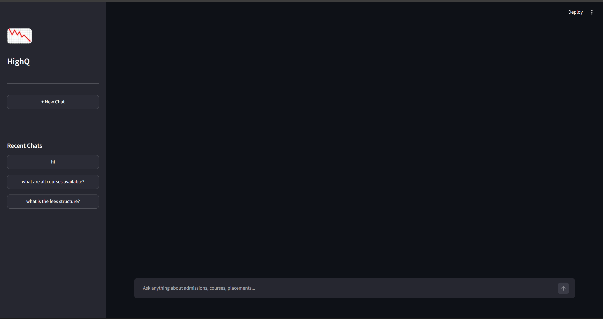

# HighQ AI Assistant

An AI powered institute enquiry chatbot built with **Streamlit**, **Groq API**, and **Llama 3.3**. The chatbot answers institute-related queries using a structured JSON knowledge base while maintaining conversation history.

---

## Application Preview



---

## Features

- AI powered question answering
- Streaming responses
- Multi chat conversation support
- Chat history management
- JSON based knowledge base
- Responsive Streamlit UI
- Secure API key management using `.env`

---

## Tech Stack

- Python
- Streamlit
- Groq API
- Llama 3.3
- JSON
- Python dotenv

---

## Installation

```bash
git clone https://github.com/Cka000/HighQ-AI-Assistant.git

cd HighQ-AI-Assistant

pip install -r requirements.txt

streamlit run main.py
```
